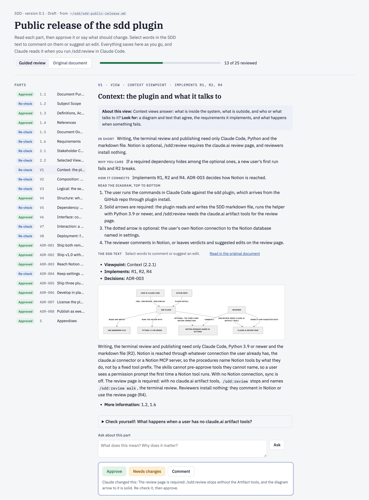

# SDD Planner: Software Design Descriptions in Claude Code

`sdd-planner` is a Claude Code plugin for writing a Software Design Description (IEEE 1016, using the [jam01 SDD template](https://github.com/jam01/SDD-Template)) one section at a time, with Claude as the guide. Each section starts with a short card on what it is and why it matters, then Claude drafts two or three concrete options from your description and your repo, and you pick one. Every requirement gets an acceptance check, every design view names the requirements it implements, and every design choice becomes a decision record. You end up with a spec you can build against.

The SDD is a plain markdown file in your repo (`docs/sdd/<slug>.md`, or `~/sdd/<slug>.md` outside a repo). Notion sync is optional.

## Demo

This plugin was designed with itself. Below is the review page (`/sdd-planner:review`) for the SDD of this public release, written with `/sdd-planner:write`, right after Claude acted on the first round of feedback: green parts are approved, and blue parts were changed by Claude and wait for a re-check, each with a line saying what changed. The second round approved all 25 parts. Each part has plain-language notes, a walk through its diagram, a "Check yourself" question, an Ask box, and Approve or Needs changes. Selecting words in the SDD text lets you comment on them or suggest an edit.



A writing turn (`/sdd-planner:write`) starts with a card like this one, then a question with two or three drafts of the section, each previewed as the exact markdown it will write:

> **Section 2 of 11 · 1.6 Requirements**
> - **What it is:** the things the system must do, numbered R1, R2 and so on, each with an acceptance check that proves it.
> - **Why it matters:** this is what turns the document into a spec you can develop against. Without checks, "done" is an opinion.
> - **You decide:** 1. the 3 to 7 must-haves; 2. a check for each; 3. the numbers.
> - **Example:** R1: while fewer than 15 environments run, a new PR gets a reachable preview environment within 10 minutes.

## Install

```bash
claude plugin marketplace add eeeemune/claude-code-sdd
claude plugin install sdd-planner@claude-code-sdd
```

Then start a new Claude Code session (or run `/reload-plugins` in an open one).

**Requires:** Claude Code, and Python 3.9 or newer as `python3` (macOS includes it). The helper script uses the standard library only. Tested on macOS; Linux and Windows are not tested yet.

## Commands

| Command | What it does |
|---------|--------------|
| `/sdd-planner:write` | Starts a new SDD or resumes a draft, one section per turn: the card, two or three drafts to pick from, then the pick is written to the file. Takes nothing, `new <title>`, a file path, or a description of what you are designing. |
| `/sdd-planner:review` | Reviews an SDD on a private claude.ai review page: builds the page the first time, then acts on the verdicts, suggested edits and comments left on it. `/sdd-planner:review walk` reviews in the terminal instead; `/sdd-planner:review notion` acts on comments left on the Notion page. |
| `/sdd-planner:publish` | Lints the SDD, bumps the version (the first publish is 1.0), adds a Revision History row, and, when Notion is on, syncs the page with its published properties and reads it back to verify it. |

## Three ways to review

| Where | How it works | Needs |
|-------|--------------|-------|
| Review page (the default) | `/sdd-planner:review` publishes a private claude.ai page: one card per part with plain-language notes, a diagram walk-through, Claude's check of the part, a "Check yourself" question, an Ask box, and Approve or Needs changes. An "Original document" tab shows the SDD as written. Select words to comment or suggest an edit. Run `/sdd-planner:review` again and Claude fixes the flagged parts, applies or declines each suggested edit, marks changed parts "Re-check" and republishes. Share the page with teammates and they can leave verdicts too. | Claude Code's claude.ai Artifact tools. Without them, `/sdd-planner:review` says so and points to `walk`. |
| Terminal | `/sdd-planner:review walk` walks the sections one per turn: what each says, how it links to the rest, what is wrong, and fixes you can apply. | Nothing extra. |
| Notion | Every section, view and decision is a closed toggle with an "About this section" note. Comment on any line, then run `/sdd-planner:review notion`: Claude changes the file, re-syncs and replies in each thread. | Notion sync turned on. |

## What it runs and sends

The commands run a local Python helper (standard library only, no network calls) and write the SDD to `docs/sdd/` or `~/sdd/`. Notion is written to only when your options name a database, through your own Notion connection. `/sdd-planner:review` publishes the SDD's text and Claude's notes as a private page in your claude.ai account. It never runs cloud CLIs such as `aws` or `kubectl`, and there is no telemetry. The full list is in [sdd/README.md](sdd/README.md#what-it-runs-and-sends).

## Options

Everything works without options, with Notion sync off. To set them, run `/plugin configure sdd-planner@claude-code-sdd` in Claude Code, or from a shell:

```bash
claude plugin configure sdd-planner@claude-code-sdd --values-stdin <<'JSON'
{
  "organization": "Acme",
  "notion_data_source_id": "00000000-0000-0000-0000-000000000000",
  "notion_title_prefix": "SDD:",
  "notion_tags_property": "Tags",
  "notion_tags": "Backend, Infra"
}
JSON
```

Claude Code keeps the options per account and hands them to the plugin's commands; start a new session after changing them. To sync to Notion, also connect Notion in Claude Code (the claude.ai Notion connector or a Notion MCP server).

| Option | Default | Meaning |
|--------|---------|---------|
| `organization` | none | Shown in the SDD's title block |
| `notion_data_source_id` | none | The database (data source) new pages go into. Without it, Notion sync is off |
| `notion_title_property` | `Name` | The page title property |
| `notion_title_prefix` | none | Put before each page title, followed by a space, for example `SDD:` |
| `notion_status_property`, `notion_status_draft`, `notion_status_published` | none | A status property and its values for a draft and a published SDD, for example `Doing` and `Done` |
| `notion_tags_property`, `notion_tags` | none | A multi-select property for the SDD's tags, and the options Claude may pick from, separated by commas |
| `notion_fixed_properties` | none | Properties set on every page, as `Name=Value` pairs separated by commas, for example `Category=Document` |
| `notion_heading_marks` | none | Three marks put in front of level 1, 2 and 3 headings on the page, separated by spaces |
| `notion_page_icon` | none | The page icon |

## The worked example

[`sdd/tests/fixtures/full.md`](sdd/tests/fixtures/full.md) is a complete SDD for per-PR preview environments on EKS: scope, four requirements with runnable checks, four views with diagrams, and two decisions. The section guide (`sdd/core/sections.md`) draws its examples from it.

## Layout

```text
.claude-plugin/marketplace.json   the marketplace "claude-code-sdd"
sdd/                              the plugin sdd-planner
  .claude-plugin/plugin.json
  skills/write|review|publish/    the three commands; each reads its procedure from core/
  core/author.md                  the guided writing flow
  core/review.md                  the review page, the terminal walk and Notion comments
  core/publish.md                 lint, release, final sync and verify
  core/sync.md                    how a file becomes a Notion page
  core/rules.md                   options, file rules, writing rules
  core/sections.md                the per-section teaching guide
  core/viewpoints.md              the 15 IEEE 1016 viewpoints and starter bundles
  core/template.md                jam01 template (commit 5dca2e5, CC0) plus 1.6 Requirements and record formats
  review-page/template.html       the review page
  scripts/sdd.py                  new, status, lint, render, props, options, meta, section, locate,
                                  review-data, review-page, review-notes, review-changed, release
  tests/                          unittest suite, fixtures, and notes on the live checks
```

## Develop

```bash
git clone https://github.com/eeeemune/claude-code-sdd
claude plugin marketplace add ./claude-code-sdd    # read in place: edits apply after /reload-plugins
cd claude-code-sdd/sdd && python3 -m unittest discover -s tests -v
```

## License

MIT, see [LICENSE](LICENSE). The SDD template is [jam01/SDD-Template](https://github.com/jam01/SDD-Template), dedicated to the public domain under CC0 1.0.
