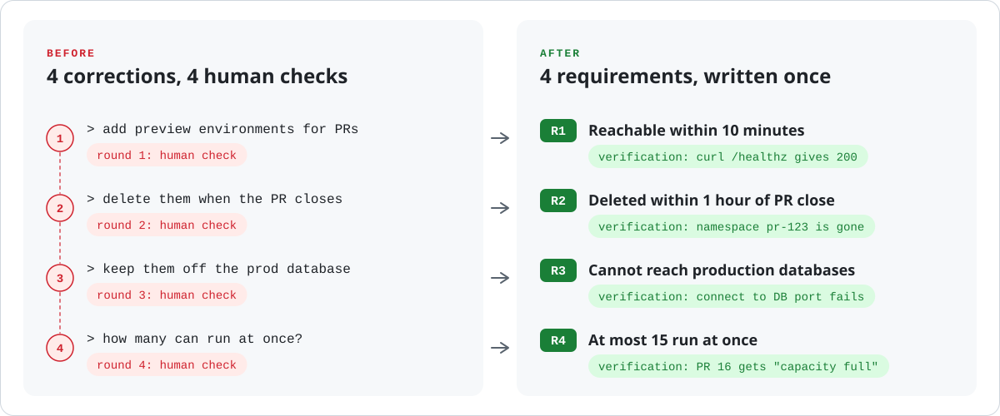
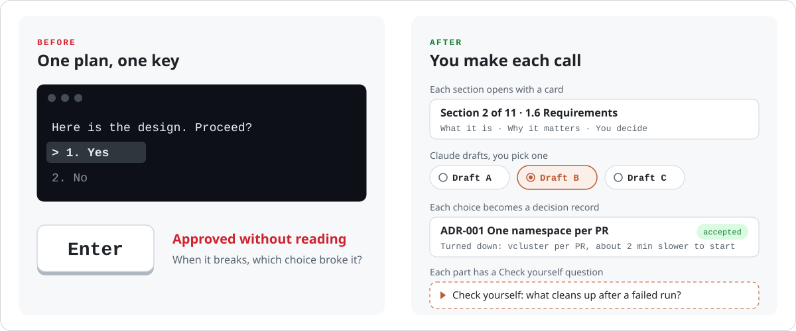
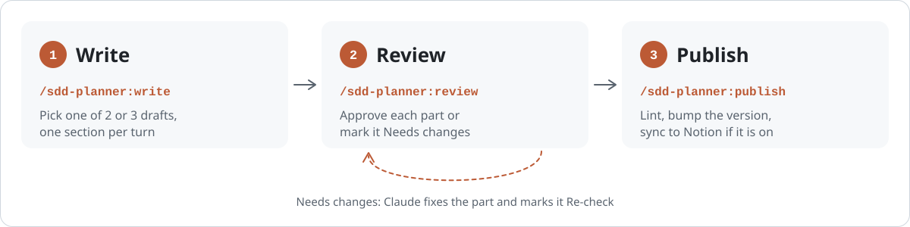
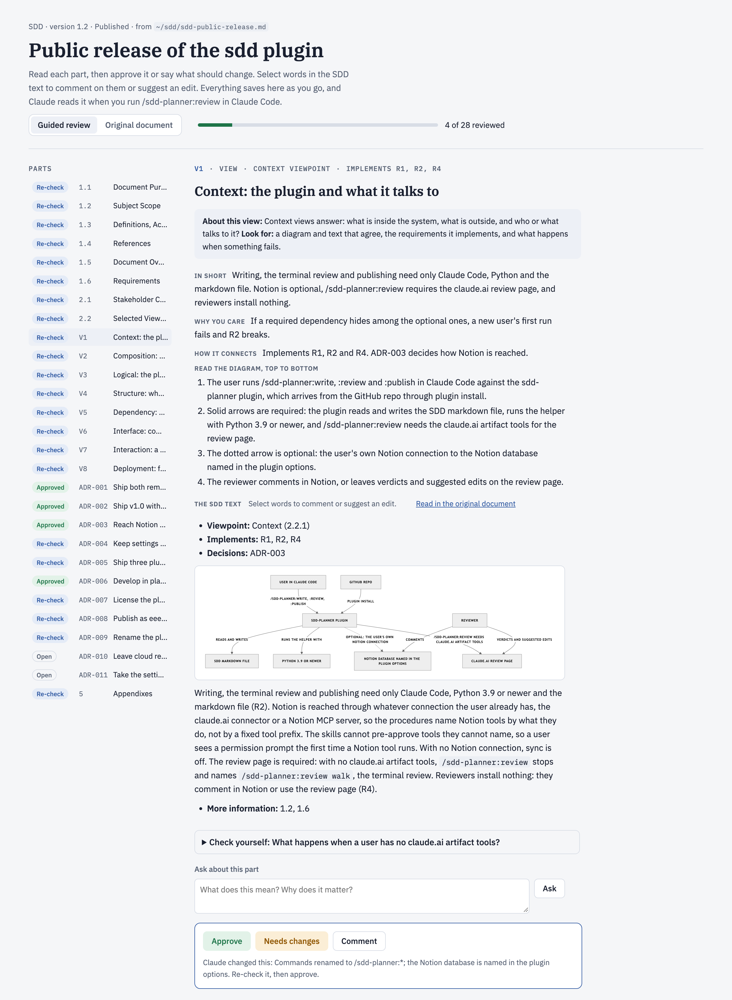

<div align="center">

# sdd-planner

### Stop iterating. Stop pressing <kbd>Enter</kbd>.

A Claude Code plugin that settles the design before the code.<br>
You make each call in a Software Design Description, Claude drafts the options,<br>
and every requirement ends with a verification you can run.

[](#install)
[](#install)
[](#what-it-runs-and-sends)
[](LICENSE)

[Stop iterating](#stop-iterating) · [Stop pressing Enter](#stop-pressing-enter) · [How it works](#how-it-works) · [Demo](#demo) · [Install](#install)

</div>

## Stop iterating

You find out what you wanted one round at a time. Each correction is a requirement you could have written down first.

<picture>
  <source media="(prefers-color-scheme: dark)" srcset=".github/readme/iterate-dark.svg">
  
</picture>

Build against the list, and you are done when the four verifications pass. The linter flags a requirement with no verification, a requirement no design view covers, and words like "fast" in a sentence with no number. The full SDD is the [worked example](sdd/examples/preview-envs.md).

## Stop pressing Enter

Claude shows a plan, asks "Proceed?", and you press <kbd>Enter</kbd> on something you skimmed. When it breaks later, you do not know which choice broke it.

<picture>
  <source media="(prefers-color-scheme: dark)" srcset=".github/readme/enter-dark.svg">
  
</picture>

## How it works

<picture>
  <source media="(prefers-color-scheme: dark)" srcset=".github/readme/flow-dark.svg">
  
</picture>

**1. Write.** Run `/sdd-planner:write` and describe what you are designing. Claude goes one section per turn: a card on what the section is for, then 2 or 3 drafts, each previewed as the exact markdown it will write. You pick one, and it lands in `docs/sdd/<slug>.md` (or `~/sdd/<slug>.md` outside a repo).

**2. Review.** Run `/sdd-planner:review` and Claude publishes a private review page in your claude.ai account. Approve each part or mark it Needs changes, comment on any words, or suggest an edit. Run the command again and Claude fixes what you flagged and marks those parts for a re-check.

**3. Publish.** Run `/sdd-planner:publish`. It lints the file, bumps the version (the first publish is 1.0), adds a Revision History row and, if you turned Notion on, syncs the page and reads it back to check it.

The SDD stays a plain markdown file in your repo, based on IEEE 1016 and the [jam01 SDD template](https://github.com/jam01/SDD-Template). Notion is optional.

## Demo

This plugin was designed with itself. Here is the review page for the SDD of its own public release:



Green parts are approved. Blue parts were changed by Claude and wait for a re-check, each with a line saying what changed. Every part has plain-language notes, a walk through its diagram, a "Check yourself" question, an Ask box, and Approve or Needs changes. Select words in the SDD text to comment on them or suggest an edit.

A writing turn starts with a card like this one, then a question with the drafts to pick from:

> **Section 2 of 11 · 1.6 Requirements**
> - **What it is:** the things the system must do, numbered R1, R2 and so on, each with an acceptance check that proves it.
> - **Why it matters:** this is what turns the document into a spec you can develop against. Without checks, "done" is an opinion.
> - **You decide:** 1. the 3 to 7 must-haves; 2. a check for each; 3. the numbers.
> - **Example:** R1: while fewer than 15 environments run, a new PR gets a reachable preview environment within 10 minutes.

## Install

```bash
claude plugin marketplace add eeeemune/claude-code-sdd
claude plugin install sdd-planner@claude-code-sdd
```

> [!TIP]
> Start a new Claude Code session (or run `/reload-plugins` in an open one), then run `/sdd-planner:write` and describe what you are building.

**Requires:** Claude Code, and Python 3.9 or newer as `python3` (macOS includes it). The helper script uses the standard library only. Tested on macOS; Linux and Windows are not tested yet.

## What it runs and sends

| What | Detail |
|---|---|
| **Runs** | A local Python helper: standard library only, no network calls |
| **Writes** | The SDD file, in `docs/sdd/` or `~/sdd/` |
| **Sends** | Notion pages, only when your options name a database, through your own Notion connection. The SDD's text and Claude's notes, as a private review page in your claude.ai account (`/sdd-planner:review`) |
| **Never** | Cloud CLIs such as `aws` or `kubectl`. No telemetry |

The full list is in [sdd/README.md](sdd/README.md#what-it-runs-and-sends).

## Reference

<details>
<summary><b>Commands</b></summary>

| Command | What it does |
|---------|--------------|
| `/sdd-planner:write` | Starts a new SDD or resumes a draft, one section per turn: the card, two or three drafts to pick from, then the pick is written to the file. Takes nothing, `new <title>`, a file path, or a description of what you are designing. |
| `/sdd-planner:review` | Reviews an SDD on a private claude.ai review page: builds the page the first time, then acts on the verdicts, suggested edits and comments left on it. `/sdd-planner:review walk` reviews in the terminal instead; `/sdd-planner:review notion` acts on comments left on the Notion page. |
| `/sdd-planner:publish` | Lints the SDD, bumps the version (the first publish is 1.0), adds a Revision History row, and, when Notion is on, syncs the page with its published properties and reads it back to verify it. |

</details>

<details>
<summary><b>Three ways to review</b></summary>

| Where | How it works | Needs |
|-------|--------------|-------|
| Review page (the default) | `/sdd-planner:review` publishes a private claude.ai page: one card per part with plain-language notes, a diagram walk-through, Claude's check of the part, a "Check yourself" question, an Ask box, and Approve or Needs changes. An "Original document" tab shows the SDD as written. Select words to comment or suggest an edit. Run `/sdd-planner:review` again and Claude fixes the flagged parts, applies or declines each suggested edit, marks changed parts "Re-check" and republishes. Share the page with teammates and they can leave verdicts too. | Claude Code's claude.ai Artifact tools. Without them, `/sdd-planner:review` says so and points to `walk`. |
| Terminal | `/sdd-planner:review walk` walks the sections one per turn: what each says, how it links to the rest, what is wrong, and fixes you can apply. | Nothing extra. |
| Notion | Every section, view and decision is a closed toggle with an "About this section" note. Comment on any line, then run `/sdd-planner:review notion`: Claude changes the file, re-syncs and replies in each thread. | Notion sync turned on. |

</details>

<details>
<summary><b>Options</b> (author name, organization, Notion sync)</summary>

Everything works without options, with Notion sync off. To set them, run `/plugin configure sdd-planner@claude-code-sdd` in Claude Code, or from a shell:

```bash
claude plugin configure sdd-planner@claude-code-sdd --values-stdin <<'JSON'
{
  "organization": "Acme",
  "author": "Ada Lovelace",
  "notion_data_source_id": "00000000-0000-0000-0000-000000000000",
  "notion_title_prefix": "SDD:",
  "notion_tags_property": "Tags",
  "notion_tags": "Backend, Infra"
}
JSON
```

Claude Code keeps the options per account and hands them to the plugin's commands; start a new session after changing them. To sync to Notion, also connect Notion in Claude Code (the claude.ai Notion connector or a Notion MCP server).

| Option | Default | Meaning |
|--------|---------|---------|
| `organization` | none | Shown in the SDD's title block |
| `author` | none | Your name on each new SDD and on the Revision History rows you add. Without it, Claude asks for the name when you start an SDD |
| `notion_data_source_id` | none | The database (data source) new pages go into. Without it, Notion sync is off |
| `notion_title_property` | `Name` | The page title property |
| `notion_title_prefix` | none | Put before each page title, followed by a space, for example `SDD:` |
| `notion_status_property`, `notion_status_draft`, `notion_status_published` | none | A status property and its values for a draft and a published SDD, for example `Doing` and `Done` |
| `notion_tags_property`, `notion_tags` | none | A multi-select property for the SDD's tags, and the options Claude may pick from, separated by commas |
| `notion_fixed_properties` | none | Properties set on every page, as `Name=Value` pairs separated by commas, for example `Category=Document` |
| `notion_heading_marks` | none | Three marks put in front of level 1, 2 and 3 headings on the page, separated by spaces |
| `notion_page_icon` | none | The page icon |

</details>

<details>
<summary><b>Repo layout</b></summary>

```text
.claude-plugin/marketplace.json   the marketplace "claude-code-sdd"
sdd/                              the plugin sdd-planner
  .claude-plugin/plugin.json
  skills/write|review|publish/    the three commands; each reads its procedure from core/
  core/author.md                  the guided writing flow
  core/review.md                  the review page, the terminal walk and Notion comments
  core/publish.md                 lint, release, final sync and verify
  core/sync.md                    how a file becomes a Notion page
  core/rules.md                   options, file rules, writing rules
  core/sections.md                the per-section teaching guide
  core/viewpoints.md              the 15 IEEE 1016 viewpoints and starter bundles
  core/template.md                jam01 template (commit 5dca2e5, CC0) plus 1.6 Requirements and record formats
  review-page/template.html       the review page
  scripts/sdd.py                  new, status, lint, render, props, options, meta, section, locate,
                                  review-data, review-page, review-notes, review-changed, release
  examples/preview-envs.md        the worked example
.github/readme/                   the README graphics (light and dark) and draw.py, which draws them (not part of the plugin)
tests/                            unittest suite, fixtures, and notes on the live checks (not part of the plugin)
```

</details>

## The worked example

[`sdd/examples/preview-envs.md`](sdd/examples/preview-envs.md) is a complete SDD for per-PR preview environments on EKS: scope, four requirements with runnable checks, four views with diagrams, and two decisions. The section guide (`sdd/core/sections.md`) draws its examples from it.

## Develop

```bash
git clone https://github.com/eeeemune/claude-code-sdd
claude plugin marketplace add ./claude-code-sdd    # read in place: edits apply after /reload-plugins
cd claude-code-sdd && python3 -m unittest discover -s tests -v
```

## License

MIT, see [LICENSE](LICENSE). The SDD template is [jam01/SDD-Template](https://github.com/jam01/SDD-Template), dedicated to the public domain under CC0 1.0.
