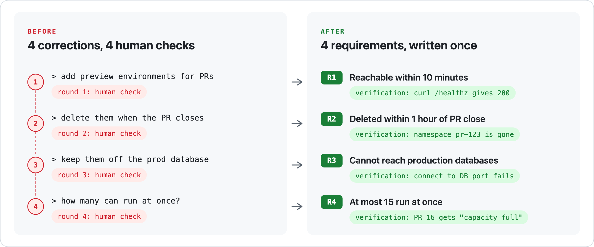
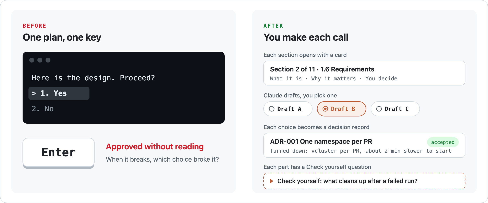
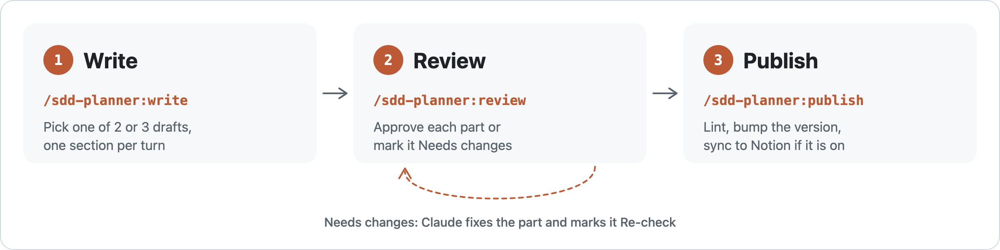

# SDD Planner: Software Design Descriptions in Claude Code

**Stop iterating. Stop pressing Enter.** SDD Planner settles the design before the code. You make each call in a Software Design Description, Claude drafts the options, and every requirement ends with a verification you can run.

## Stop iterating

You find out what you wanted one round at a time. Each correction is a requirement you could have written down first.



Build against the list, and you are done when the four verifications pass. The linter flags a requirement with no verification, a requirement no design view covers, and words like "fast" in a sentence with no number. The full SDD is the [worked example](https://github.com/eeeemune/claude-code-sdd/blob/main/sdd/examples/preview-envs.md).

## Stop pressing Enter

Claude shows a plan, asks "Proceed?", and you press Enter on something you skimmed. When it breaks later, you do not know which choice broke it.



## How it works



The SDD follows IEEE 1016, using the [jam01 SDD template](https://github.com/jam01/SDD-Template), and it is a plain markdown file in your repo. Every design view names the requirements it implements. Notion sync is optional.

| Command | What it does |
|---------|--------------|
| `/sdd-planner:write` | Starts a new SDD or resumes a draft, one section per turn: the card, two or three drafts to pick from, then the pick is written to the file. |
| `/sdd-planner:review` | Reviews the SDD on a private claude.ai review page: plain-language notes, a diagram walk-through, Claude's check of each part, Approve or Needs changes, comments and suggested edits. Run it again and Claude acts on the feedback. `/sdd-planner:review walk` reviews in the terminal; `/sdd-planner:review notion` acts on comments on the Notion page. |
| `/sdd-planner:publish` | Lints the SDD, bumps its version (the first publish is 1.0), adds a Revision History row, and, when Notion is on, syncs the page and reads it back to verify it. |

## Demo

This plugin was designed with itself. Below is the review page for the SDD of its own public release, right after the rename to sdd-planner: green parts were approved and did not change, blue parts were changed by Claude and wait for a re-check, each with a line saying what changed, and the two new decisions are still open.


## Install

Search for **SDD Planner** in Anthropic's plugin directory: run `/plugin directory` in Claude Code, or open Customize > Plugins > Discover on claude.ai, and the plugin reaches Claude Code the next time you start a session. Or add it from GitHub:

```bash
claude plugin marketplace add eeeemune/claude-code-sdd
claude plugin install sdd-planner@claude-code-sdd
```

**Requires:** Claude Code, and Python 3.9 or newer as `python3` (macOS includes it). The review page also needs Claude Code's claude.ai Artifact tools. Tested on macOS. The commands are built for Claude Code: they run a local Python helper and write files, which claude.ai chat and Cowork may not allow.

## What it runs and sends

- **On your machine:** the commands run the plugin's helper, `python3 scripts/sdd.py`, which uses the Python standard library only and makes no network calls. It creates, checks and renders the SDD file. The SDD is written to `docs/sdd/` in the current git repo, or to `~/sdd/`. Claude Code passes the plugin options you set into the commands, and to draft sections Claude reads files in the current repo such as READMEs, manifests, and CI and deploy configuration. The author name on an SDD comes from the `author` option, or Claude asks you for it.
- **Links you give it:** read with the connectors your session already has, such as Notion, Slack or Asana. Nothing is written to them, apart from Notion as described next.
- **Notion, only when your options name a database:** creates and updates the SDD's page in that database, and reads and replies to comments on it, through your own Notion connection.
- **claude.ai review page, with `/sdd-planner:review`:** publishes the SDD's text and Claude's notes as a private page in your claude.ai account, and reads the verdicts, suggested edits and comments saved on it. The page's Ask box sends one part of the SDD and your question to Claude. Only you, and people you share the page with, can open it. The page loads its fonts from Google Fonts.
- **Nothing else:** no cloud CLIs such as `aws` or `kubectl`, no telemetry, and no other network calls.

## Options

Everything works without options, with Notion sync off. To set your author name or organization, or to sync to Notion, run `/plugin configure sdd-planner@claude-code-sdd`, then start a new session. The [repository README](https://github.com/eeeemune/claude-code-sdd#options) lists every option.

## License

MIT. The SDD template is jam01/SDD-Template, dedicated to the public domain under CC0 1.0.
