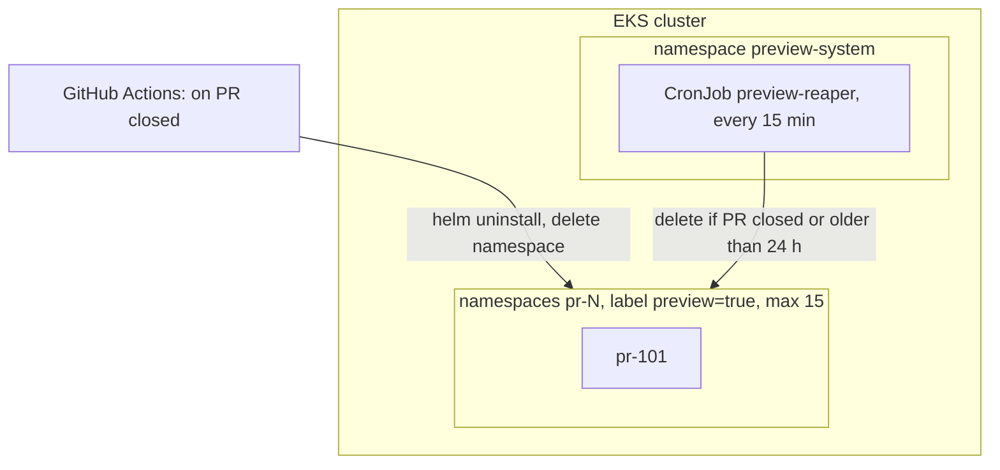

# Section guide

One block per section, in writing order. Each block feeds one section turn:

- the card shows **What it is**, **Why it matters**, **You decide** and a 1 to 3 line version of **Example**;
- the drafts are built from the sources in **Drafts from**, in the shape shown in **Example**;
- the question screen follows **Choice type**;
- `/sdd-planner:review` judges the section with **Review checks**.

The running example is per-PR preview environments on EKS. The complete document is `examples/preview-envs.md` in this plugin; show it when someone asks "what does a finished one look like?".

Writing order is not reading order. Scope and requirements come first because everything else is judged against them. The glossary, references and overview come last because only then is it known which terms and links the document uses.

## 1.2 Subject Scope
- **Order:** 1 of 11. Required.
- **What it is:** names the system and its version, says in one or two sentences what it is for, and lists what is in scope and what is explicitly out.
- **Why it matters:** every later section is checked against it. Without an out-of-scope list, each reviewer assumes their favorite feature is included, and the design grows during review.
- **Look for:** a clear out-of-scope list, and no tools or diagrams yet (those belong in Section 3).
- **You decide:**
  1. the system's name and version (v1, or a release name);
  2. its purpose in one sentence: who gets what;
  3. 3 to 6 things in scope;
  4. 2 to 5 things explicitly out of scope, with "planned for v2" where that is true.
- **Drafts from:** the description, the links given at setup (Asana, Slack, Notion), the repo README.
- **Choice type:** pick a draft. Draft A is the narrowest scope that still meets the purpose. Draft B is A plus the most likely next addition, named as such. If A and B differ in what gets built, the pick is a design choice: add a proposed ADR such as "v1 ships without backend previews".
- **Example:**

```markdown
**System:** Preview environment pipeline, v1.

**Purpose:** every pull request on the web app repo gets a working copy of the app at its own URL, so reviewers can use the change before it merges.

**In scope:**
- build and deploy on PR open and on every push to the PR
- one URL per PR: `https://pr-<number>.preview.example.com`
- removal when the PR closes, plus a reaper for anything left behind
- a cap on how many environments run at once

**Out of scope:**
- production deploys
- seeding real or production data (each environment uses a fixed fixture)
- previews for backend repos (planned for v2)
```

- **Review checks:**
  - it names a version;
  - it has an explicit out-of-scope list;
  - every in-scope item is covered by at least one requirement in 1.6;
  - it holds no implementation detail (tools, diagrams): that belongs in Section 3.

## 1.6 Requirements
- **Order:** 2 of 11. Required. This section is added to the jam01 template by this skill.
- **What it is:** the things the system must do, numbered R1, R2 and so on, each with an acceptance check that proves it.
- **Why it matters:** this is what turns the document into a spec you can develop against. A requirement with a check can be tested by you, a reviewer or Claude. Without checks, "done" is an opinion. Each design view in Section 3 says which requirements it implements, so you can see that every requirement is designed for.
- **Look for:** a check you could actually run on every row, numbers instead of vague words, and no two requirements that contradict each other.
- **You decide:**
  1. the 3 to 7 must-haves (fewer is better; more than 7 usually means the scope in 1.2 is too big);
  2. for each, a check: Given/When/Then for behavior, or a command and its expected result for limits;
  3. the numbers: time limits, counts, sizes. A number nobody knows yet is written as `{{...}}` and filled before publishing.
- **Drafts from:** the description, 1.2 (each in-scope item usually becomes at least one requirement), linked tickets, and requirement IDs that already exist in the repo (`specs/`, `docs/srs*`). When the repo already has IDs such as `SEL-001`, cite those instead of creating R-numbers.
- **Choice type:** pick a draft. Draft A is the minimum set with checks. Draft B has stricter numbers, or one extra requirement A leaves out (security, cost, cleanup). When B adds a requirement, the pick is a design choice and becomes a proposed ADR (for example "v1 leaves out isolation from production"). Notes on a pick are the usual way to change one number.
- **Watch for:** requirements that contradict each other at a limit. "Every new PR gets an environment in 10 minutes" and "at most 15 run at once" both fail when 15 run, so the first one needs "while fewer than 15 run". Start time limits at the triggering event (the PR opening), not at a later step (CI finishing) that might never happen.
- **Example:**

```markdown
| ID | Requirement | Acceptance check |
|----|-------------|------------------|
| R1 | While fewer than 15 environments run, a new PR gets a reachable preview environment within 10 minutes | Given 14 or fewer running environments and PR 123 opened at T0, then by T0 + 10 min `curl -fsS https://pr-123.preview.example.com/healthz` returns 200 |
| R2 | An environment is deleted within 1 hour of its PR closing | Given a closed PR, when 60 min pass, then `kubectl get ns pr-123` returns NotFound |
| R3 | A preview environment cannot reach production databases | Given a running environment, when a Job in namespace pr-123 runs `nc -z -w 3 <ip> 5432` against each production database IP, then every connection fails, while the same Job can connect to the environment's own Postgres |
```

- **Review checks:**
  - every row has an acceptance check (lint: req-no-check);
  - each check is something a person or a script can actually run or observe;
  - no vague word ("fast", "scalable") without a number;
  - nothing from 1.2's out-of-scope list appears here;
  - every requirement is implemented by at least one view (lint: req-orphan).

## 1.1 Document Purpose
- **Order:** 3 of 11. Required.
- **What it is:** 2 to 4 sentences on why this document exists, who reads it, and how they use it.
- **Why it matters:** it sets the rules for the document. If it says "Claude implements against Sections 1.6, 3 and 4", those sections have to be exact enough to build from, and everyone knows a design change starts here, not in the code.
- **Look for:** who reads this, whether the system is built from it, and where changes are made.
- **You decide:**
  1. the readers: you, reviewers, the team that uses the system, on-call, Claude as the implementer;
  2. prescriptive (the system will be built from this) or descriptive (this documents what already runs);
  3. where design changes are made (normally: in this file first).
- **Drafts from:** the kind chosen at setup (new means prescriptive, existing means descriptive, change means both), 1.2, the readers implied by the links.
- **Choice type:** pick a draft. The drafts differ in audience and emphasis, not design, so no ADR.
- **Example:** "This SDD describes how per-PR preview environments are built and run. It is prescriptive: the system is built from it. Readers are the infra owner, design reviewers, the web team that uses the environments, and on-call. Claude Code implements against Sections 1.6, 3 and 4, and any design change is made in this file first."
- **Review checks:**
  - 4 sentences or fewer;
  - it says prescriptive or descriptive;
  - its readers match the stakeholders in 2.1;
  - it says where changes are made.

## 2.1 Stakeholder Concerns
- **Order:** 4 of 11. Required.
- **What it is:** a table of the people or teams who care about this system and the main thing each of them worries about.
- **Why it matters:** each concern is a reason to draw one view in Section 3. A concern with no view means nobody checked it. A view with no concern is probably not needed.
- **Look for:** roles rather than names, each with a question that role would really ask.
- **You decide:**
  1. the stakeholder types (roles, not names);
  2. each one's main concern, written as a question they would actually ask;
  3. nothing else yet: the "Addressed by" column is filled in after Section 3.
- **Drafts from:** the readers in 1.1, 1.2, and 1.6 (each requirement usually answers someone's concern).
- **Choice type:** pick a draft. Draft A has the 3 or 4 core stakeholders. Draft B adds the ones people forget (security, finance, on-call) when they apply. No ADR.
- **Example:**

```markdown
| Stakeholder | Main concern | Addressed by |
|-------------|--------------|--------------|
| Reviewers (web team) | Is there a working link on my PR within minutes? | R1, V1, V3 |
| Infra owner | Can environments pile up or cost more than planned? | R2, R4, V4, ADR-002 |
| Security | Can a preview environment touch production data? | R3, V2, ADR-001 |
| On-call | Can I find and delete a stuck environment? | V4 |
```

- **Review checks:**
  - each concern is a question someone would ask, not a feature;
  - every concern is addressed by at least one requirement or view;
  - roles, not names.

## 2.2 Selected Viewpoints
- **Order:** 5 of 11. Required.
- **What it is:** which of the 15 standard viewpoints (ways of looking at a system) this document uses, with a one-line note for each on which concerns it answers and which diagram it uses. The diagrams themselves go in Section 3.
- **Why it matters:** drawing all 15 is wasted work, and drawing the wrong 3 leaves concerns unchecked. Picking on purpose, and saying why the rest are left out, tells the reader what was considered.
- **Look for:** a reason for each picked viewpoint, and for the ones left out.
- **You decide:**
  1. which viewpoints, usually 3 to 6 (`viewpoints.md` has starter bundles by kind of work);
  2. the one-line reason for each pick, and for leaving the rest out.
- **Drafts from:** the kind of work, the 2.1 concerns, the bundles in `viewpoints.md`, and the repo (a Helm chart suggests Deployment, a database schema suggests Information, an API suggests Interface).
- **Choice type:** one screen with four multi-select questions (Structure, Data, Behavior, Runtime), recommended picks marked. Then Claude writes 2.2 and shows it; no second question unless something looks wrong.
- **Example:**

```markdown
Four viewpoints answer the concerns in 2.1. Not used: Logical, Physical, Structure, Dependency, Information, Interface, Algorithm, State Dynamics, Concurrency, Patterns, Resources, because the design wires existing components together and adds no new code paths or data stores.

#### 2.2.1 Context
Addresses: the system boundary and who triggers what (reviewers, on-call). Diagram: mermaid flowchart TB.

#### 2.2.14 Deployment
Addresses: where each part runs, how environments are removed, and the cap (infra owner, on-call). Diagram: mermaid flowchart TB.
```

- **Review checks:**
  - every concern in 2.1 maps to at least one picked viewpoint;
  - every picked viewpoint has a view in Section 3 (lint: viewpoint-unused);
  - the "Not used" line gives a reason;
  - unpicked 2.2.x headings are removed.

## 3 Design Views
- **Order:** 6 of 11. Required.
- **What it is:** the design itself. One view per picked viewpoint: a diagram plus a few lines of text, detailed enough to build the system (prescriptive) or to operate it (descriptive).
- **Why it matters:** this is what gets built and reviewed. The Implements line ties each view to requirements, so every requirement is designed for and nothing is designed without a reason.
- **Look for:** a diagram and text that agree, the requirements it implements, and what happens when something fails.
- **You decide, per view:**
  1. what the diagram shows (the boxes and the arrows);
  2. what the text adds that the diagram can't: limits, timings, what happens on failure;
  3. which requirements it implements and which decisions shaped it.
- **Drafts from:** 1.2, 1.6, 2.1, 2.2, the viewpoint's block in `viewpoints.md`, repo files (manifests, Helm charts, Terraform, CI workflows), and for kind existing or change, what runs today as the "What runs today" rule in `rules.md` says: the repo's deploy configuration, or what the user tells you.
- **Choice type:** one turn per view. When there is a real design alternative (namespace per PR or vcluster per PR), Draft A and Draft B are those alternatives and the pick becomes a proposed ADR. When there is none, Draft B is a simpler or a more detailed version of A, and no ADR is added.
- **Record format** (one per view, numbered V1, V2 and so on):

````markdown
### V4 Deployment: where it runs and how it is removed
- **Viewpoint:** Deployment (2.2.14)
- **Implements:** R2, R4
- **Decisions:** ADR-001, ADR-002



Two paths remove an environment: the PR-closed workflow (normal path) and the reaper (catches failed or cancelled runs). Either path alone meets R2.

- **More information:** `charts/web-app`, the preview workflow
````

- **Review checks:**
  - every view has Viewpoint, Implements (or "none" with a reason) and a diagram;
  - flowcharts run top to bottom and labels with punctuation are quoted (lint);
  - the text and the diagram agree;
  - an Interaction view shows a failure path, not only the happy path;
  - every requirement is implemented by at least one view (lint: req-orphan).

## 4 Decisions
- **Order:** 7 of 11. Required.
- **What it is:** one record, an ADR (Architecture Decision Record), per important design choice: the problem, the options considered, the option chosen and why.
- **Why it matters:** the rest of the document says what is built. The ADRs say why, which is what a future reader, or Claude months later, needs before changing it. A record with only one option is a statement, not a decision.
- **Look for:** at least two real options, and a reason tied to a requirement or a constraint.
- **You decide:**
  1. which proposed ADRs (collected during earlier turns) to keep, edit or drop;
  2. whether a decision is missing (a choice made before this document, such as "reuse the existing ingress", still counts);
  3. for each, the real reason: cost, time, risk, existing tooling, a requirement.
- **Drafts from:** the design choices made in earlier turns (already in Section 4 with `Status: proposed`), and decisions visible in the repo or the links.
- **Choice type:** one multi-select screen "Keep which?" over the proposed ADRs (kept ones become `Status: accepted`, the rest are deleted), then one question "Any decision missing?", then a turn for any ADR with fewer than two options.
- **Record format** (one per decision, numbered ADR-001, ADR-002 and so on):

```markdown
### ADR-002 Two removal paths: PR-closed workflow and a reaper
- **Status:** accepted
- **Context:** environments must be gone within 1 hour of the PR closing (R2), and one failed workflow run must not leave an environment running.
- **Options:**
  - PR-closed workflow only
  - reaper CronJob only
  - both
- **Outcome:** Chosen option: "both", because the workflow removes the environment within minutes in the normal case, and the reaper catches runs that failed or were cancelled.
- **More information:** V4
```

- **Review checks:**
  - one decision per record;
  - at least two options (lint: decision-incomplete);
  - the outcome names the chosen option and a reason tied to a requirement or a constraint;
  - every ADR is referenced by at least one view's Decisions line;
  - no ADR is left at `Status: proposed` when publishing (lint: adr-proposed).

## 5 Appendixes
- **Order:** 8 of 11. Optional.
- **What it is:** supporting material that helps but is not the design: data samples, cost estimates, links to dashboards, long tables.
- **Why it matters:** it keeps Sections 1 to 4 short. If there is nothing, one line saying so is better than an empty heading.
- **Look for:** nothing here that you need in order to understand Sections 1 to 4.
- **You decide:** whether there is anything worth attaching.
- **Drafts from:** details mentioned in earlier turns that were left out as too detailed.
- **Choice type:** pick. The first option is "Not applicable". The second is a short list of the leftovers, offered only when there are any.
- **Example:** `_Not applicable: no supporting material for v1._`
- **Review checks:**
  - nothing here is needed to understand Sections 1 to 4;
  - each item is referenced from the main text.

## 1.4 References
- **Order:** 9 of 11. Recommended.
- **What it is:** the external documents this design depends on or cites, with title, owner, version or date, location, and whether each one is binding (normative) or background (informative).
- **Why it matters:** a normative reference is part of the contract. If the Helm chart or API spec it points to changes, this design may have to change too.
- **Look for:** which references are binding (normative), and links that will still work later.
- **You decide:**
  1. which of the collected links to keep;
  2. which ones are normative.
- **Drafts from:** every link and file path mentioned in the document or given at setup, plus the SDD template itself.
- **Choice type:** one multi-select screen "Which are normative?" over the collected references, then confirm the table.
- **Example:**

```markdown
| Title | Owner | Version or date | Location | Type |
|-------|-------|-----------------|----------|------|
| web-app Helm chart | Web team | chart 2.3.0 | `charts/web-app` | Normative |
| GitHub Actions workflow syntax | GitHub | 2026 | https://docs.github.com/actions | Informative |
```

- **Review checks:**
  - every link used in the document is listed;
  - stable locations (repo paths, versioned docs) rather than chat links;
  - each row says normative or informative.

## 1.3 Definitions, Acronyms, and Abbreviations
- **Order:** 10 of 11. Recommended.
- **What it is:** an alphabetized table of the terms and acronyms a reader might not know.
- **Why it matters:** a reader from another team, or Claude in a new session, reads "TTL" or "reaper" the way you meant it.
- **Look for:** every acronym the document uses, defined the way this document means it.
- **You decide:** which extracted terms to define. The template's sample rows (API, SDD) are replaced unless the document actually uses them. Its SDD row is also wrong: it says "Software Design Document" and stops mid-sentence. The right definition is Software Design Description (IEEE 1016), a document that describes how a system is built and why.
- **Drafts from:** acronyms (two or more capital letters) and project-specific words that appear in the document.
- **Choice type:** multi-select screens with up to 4 terms per question and up to 4 questions per screen, then confirm the table with Claude's definitions.
- **Example:**

```markdown
| Term | Definition |
|------|------------|
| Reaper | The CronJob that deletes preview environments whose PR is closed or that are older than the TTL |
| TTL | Time to live: how long an environment may exist before the reaper removes it (24 h) |
```

- **Review checks:**
  - alphabetized;
  - every acronym in the document is defined, or is common knowledge for the readers in 1.1;
  - each definition says what the term means here, not a dictionary definition.

## 1.5 Document Overview
- **Order:** 11 of 11. Recommended.
- **What it is:** 3 to 5 sentences on how the document is organized and how changes are tracked.
- **Why it matters:** it lets a reader jump to the part they need. It is written last because only now is the structure final.
- **Look for:** section names and counts that match the document.
- **You decide:** confirm or edit a generated summary.
- **Drafts from:** the finished document: how many requirements, which viewpoints, how many views and ADRs.
- **Choice type:** pick a draft. Draft A has 3 sentences. Draft B has 5 and also says how to propose a change. No ADR.
- **Example:** "Section 1 sets the scope and the requirements (R1 to R4). Section 2 lists who cares about what and the four viewpoints chosen to answer them. Section 3 has one view per viewpoint, and each view names the requirements it implements. Section 4 records the two decisions that shaped the design. Changes are made in this file and tracked in the Revision History."
- **Review checks:**
  - it matches the actual sections and counts;
  - it says where changes are made.

## Automatic parts (no section turn)
- **Title block** (`# Software Design Description`, `## For <title>`, version, author, organization, date): filled by `sdd.py new`. `sdd.py release` updates the version line.
- **Table of Contents:** fixed by the template. On Notion it becomes a table of contents block.
- **Revision History:** `sdd.py new` adds the 0.1 row; `sdd.py release` adds one row per publish.
