# Viewpoint guide

IEEE 1016 lists 15 viewpoints: ways of looking at a system, each answering one kind of question. An SDD picks the 3 to 6 that answer its stakeholders' concerns (section 2.2), then draws one view per picked viewpoint (Section 3). This file is what Claude uses to recommend picks and to draft the views. Diagrams are mermaid; every flowchart runs top to bottom (`flowchart TB`).

## Selection screen

Four multi-select questions, one per group (the question tool allows 4 options per question):

| Header | Options |
|--------|---------|
| Structure | Context, Composition, Logical, Structure |
| Data | Information, Interface, Dependency, Patterns |
| Behavior | Interaction, Algorithm, State Dynamics, Concurrency |
| Runtime | Physical, Deployment, Resources |

Start each recommended option's description with "(Recommended)" and give the reason in a few words tied to a 2.1 concern.

## Starter bundles

| Kind of work | Start with |
|--------------|-----------|
| Infra or platform change (cluster, CI/CD, networking) | Context, Composition, Deployment, Interaction |
| Backend service or API | Context, Composition, Interface, Information, Interaction |
| Data pipeline (Airflow, ClickHouse, Snowflake) | Context, Composition, Information, Interaction, Deployment |
| Frontend feature | Context, Composition, Interface, State Dynamics |
| CLI, library or Claude skill | Context, Composition, Interface, Algorithm |

Then adjust: add a viewpoint when a 2.1 concern has no home (a "can two jobs collide?" concern means Concurrency), drop one when no concern needs it.

## Diagram rules

- Flowcharts run top to bottom: `flowchart TB`. Subgraphs keep the same direction.
- Quote any label that has punctuation: `db["Postgres (fixture data)"]`. Edge labels too: `-->|"helm upgrade --install"|`.
- Line breaks inside a label are ` `.
- About 15 nodes at most. A bigger picture is two views.
- One diagram per view. The text under it says what the diagram leaves out.

## 2.2.1 Context
- **Answers:** what is inside the system, what is outside, and who or what talks to it?
- **Pick it when:** almost always. It is the first diagram a new reader needs.
- **Skip it when:** the SDD covers one internal module of a system whose context is documented elsewhere (link that document instead).
- **Diagram:** `flowchart TB` with the system as one box and the people and systems around it.

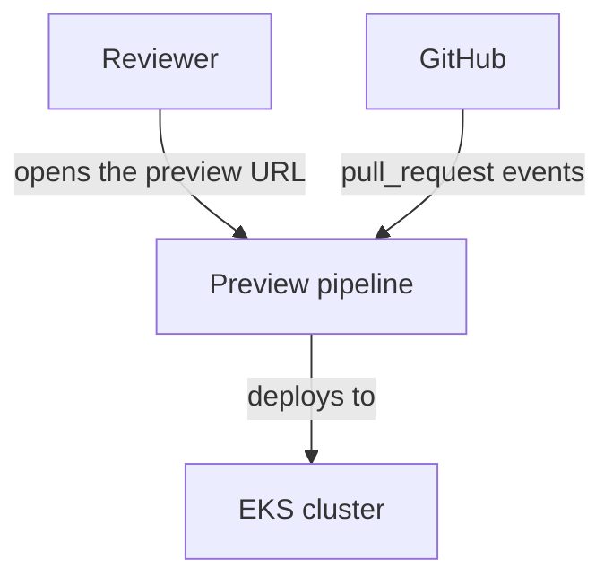

## 2.2.2 Composition
- **Answers:** what are the major parts, and what is each one responsible for?
- **Pick it when:** the system has more than one deployable, service or module.
- **Skip it when:** it is a single script or a single process with no internal split worth showing.
- **Diagram:** `flowchart TB` with one subgraph per component or namespace.

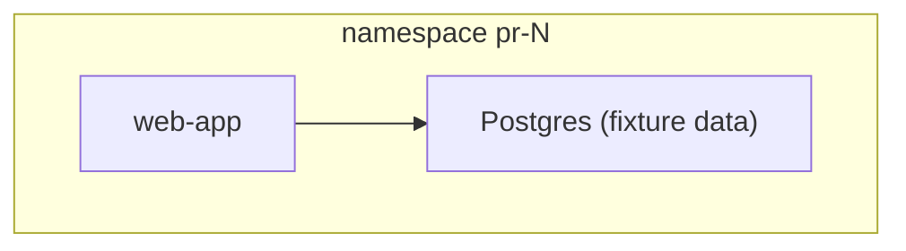

## 2.2.3 Logical
- **Answers:** what are the main types (classes, interfaces) and how do they relate?
- **Pick it when:** you are designing new code with several core types: a library, a domain model, an SDK.
- **Skip it when:** the work is infra wiring or configuration with no new types.
- **Diagram:** `classDiagram`.

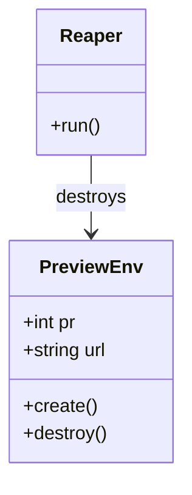

## 2.2.4 Physical
- **Answers:** what hardware or cloud infrastructure exists, and how is it connected?
- **Pick it when:** you provision infrastructure (VPCs, subnets, node groups, buckets) or the network layout matters.
- **Skip it when:** everything runs on an existing cluster or platform you do not change.
- **Diagram:** `flowchart TB` with nested subgraphs for VPC, subnets and node groups.

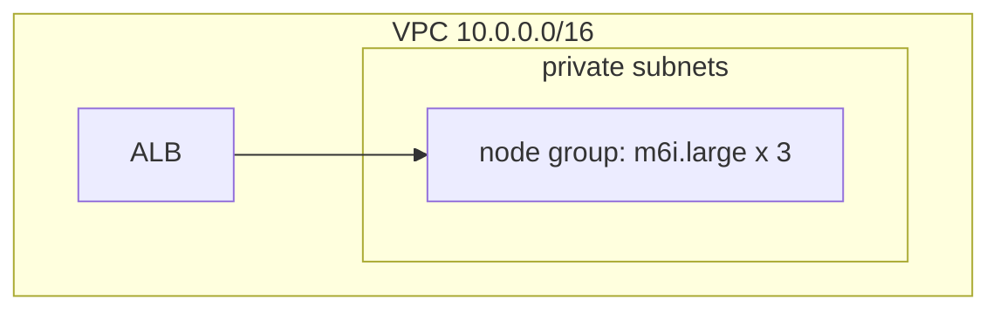

## 2.2.5 Structure
- **Answers:** what is inside one complex component: its parts, ports and connectors?
- **Pick it when:** one component is complex enough to need its own breakdown (a CI workflow with several stages, a service with internal workers).
- **Skip it when:** every component is simple enough to understand from the Composition view.
- **Diagram:** `flowchart TB` inside one subgraph.

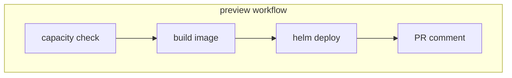

## 2.2.6 Dependency
- **Answers:** what depends on what, and what breaks if one piece changes?
- **Pick it when:** there are many modules or services, or a migration where the order of changes matters.
- **Skip it when:** there are few parts and the links are obvious from Composition.
- **Diagram:** `flowchart TB` with labeled "uses" or "requires" arrows.

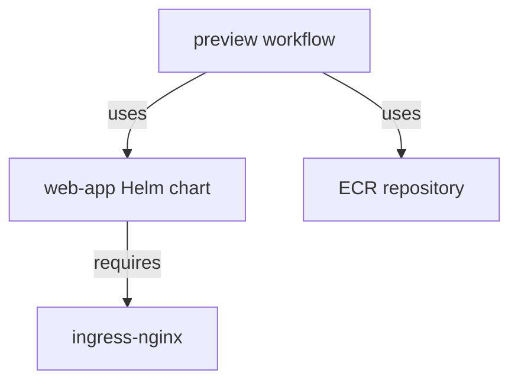

## 2.2.7 Information
- **Answers:** what data is stored, in what shape, and who owns it?
- **Pick it when:** there are new tables, schemas, buckets, queues or data contracts.
- **Skip it when:** nothing is stored beyond what existing systems already own.
- **Diagram:** `erDiagram`.

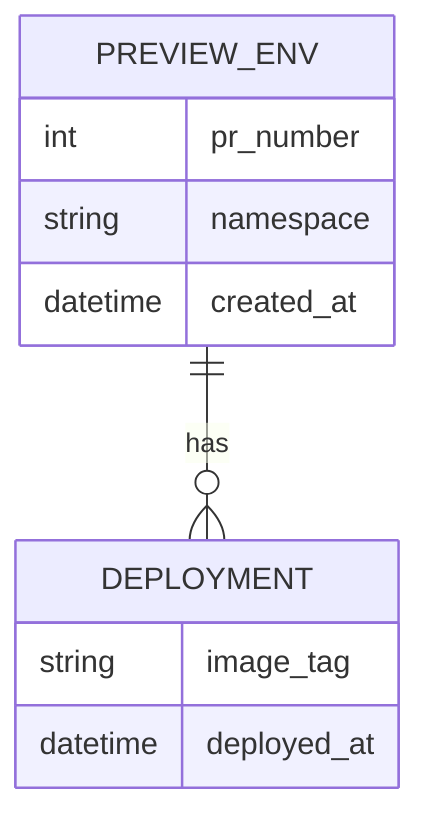

## 2.2.8 Interface
- **Answers:** what exactly can other parts call, with what inputs and outputs, and what errors?
- **Pick it when:** there is an API, a CLI, an event or a file format that other parts depend on.
- **Skip it when:** nothing outside the system calls into it.
- **Diagram:** a table of operations, plus a code block with the exact contract (an OpenAPI snippet, the CLI usage, or function signatures).

| Operation | Input | Output | Errors |
|-----------|-------|--------|--------|
| `POST /previews` | `{"pr": 123}` | `201 {"url": "..."}` | `409` capacity full |
| `DELETE /previews/{pr}` | path `pr` | `204` | `404` unknown PR |

## 2.2.9 Interaction
- **Answers:** who calls whom, in what order, and what happens when a step fails?
- **Pick it when:** a flow crosses three or more parts, or timing matters (a requirement has a time limit).
- **Skip it when:** every operation is a single call with no ordering.
- **Diagram:** `sequenceDiagram` with the happy path and at least one failure path in an `alt` block.

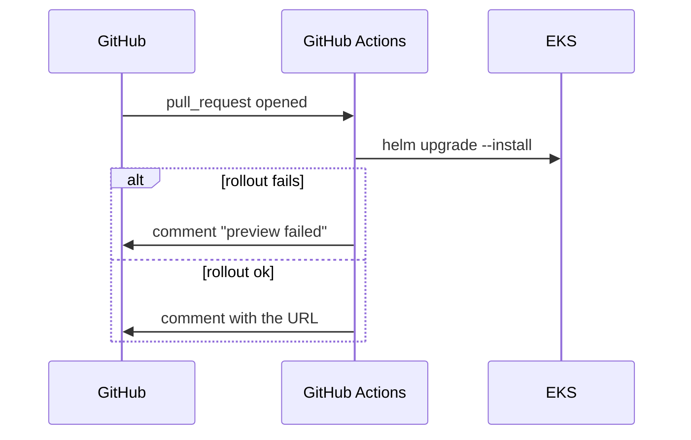

## 2.2.10 Algorithm
- **Answers:** how does one non-trivial operation decide what to do, step by step?
- **Pick it when:** there is logic others must get exactly right: a scheduling rule, matching, scoring, retry and backoff, cleanup criteria.
- **Skip it when:** the code is create, read, update, delete and glue.
- **Diagram:** `flowchart TB` with decision nodes, or a pseudocode block.

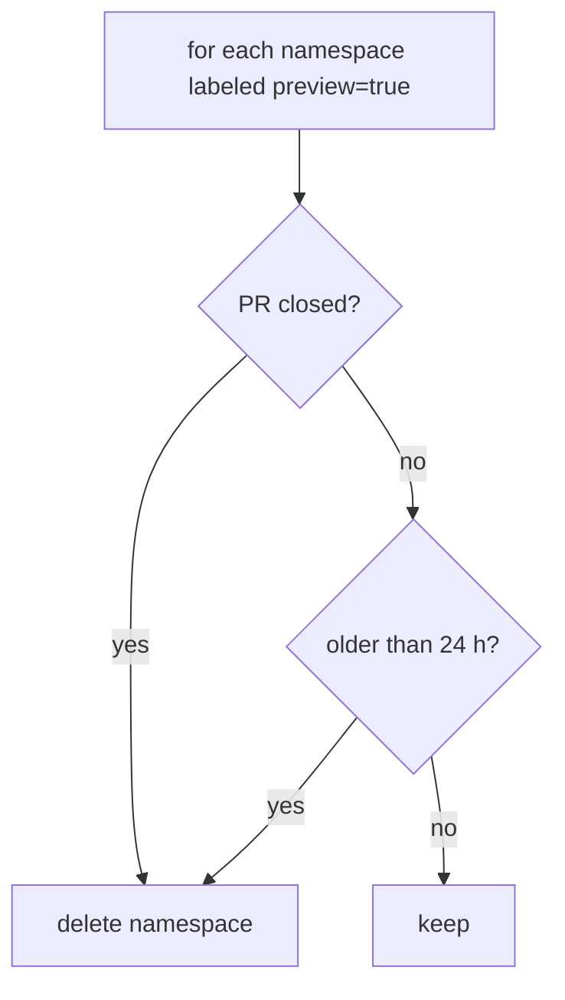

## 2.2.11 State Dynamics
- **Answers:** what states can a thing be in, and what moves it from one to another?
- **Pick it when:** something has a lifecycle (a job, an environment, an order) and behavior depends on its state.
- **Skip it when:** requests are stateless.
- **Diagram:** `stateDiagram-v2` (it runs top to bottom by default).

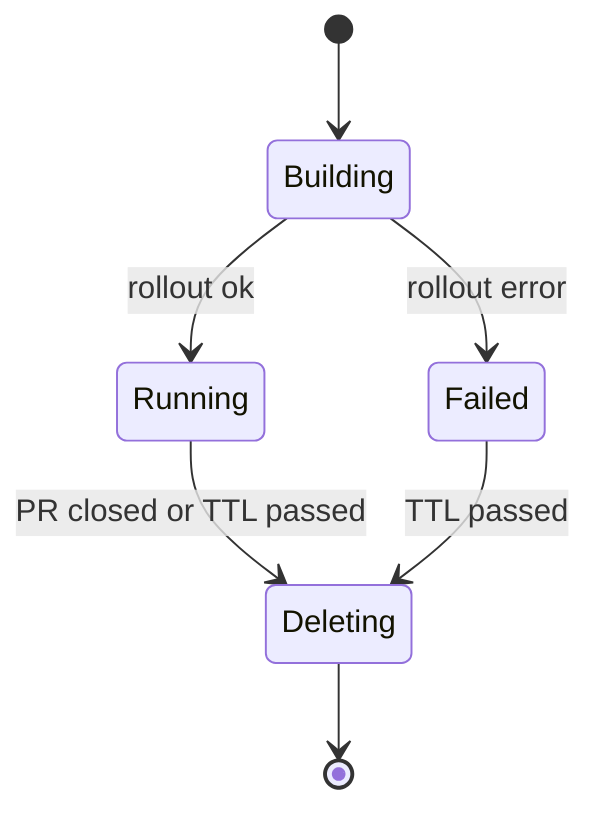

## 2.2.12 Concurrency
- **Answers:** what runs at the same time, and what stops two things from colliding?
- **Pick it when:** there are parallel workers, locks or queues, or two paths that can act on the same thing (the PR-closed workflow and the reaper both deleting one namespace).
- **Skip it when:** everything runs strictly one step after another.
- **Diagram:** `sequenceDiagram` with `par` blocks.

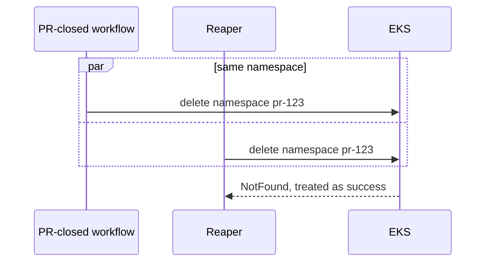

## 2.2.13 Patterns
- **Answers:** which known patterns does the design use, and where?
- **Pick it when:** the design relies on a pattern readers should recognize: reconcile loop, outbox, sidecar, circuit breaker, leader election.
- **Skip it when:** there is no notable pattern.
- **Diagram:** a few lines naming the pattern and where it is used, plus a `flowchart TB` of the pattern's roles.

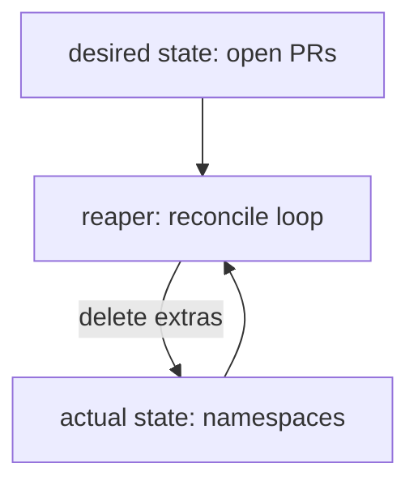

## 2.2.14 Deployment
- **Answers:** what runs where, in which environment, and how does it get there?
- **Pick it when:** almost always for infra work, and for anything that runs as a service.
- **Skip it when:** it is a library or a local tool with no runtime of its own.
- **Diagram:** `flowchart TB` with one subgraph per environment, cluster or namespace, plus the pipeline that deploys into it.

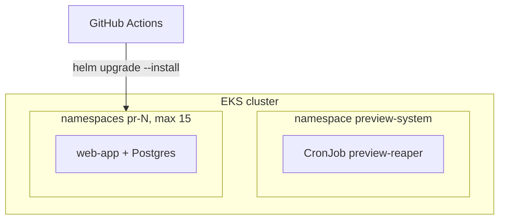

## 2.2.15 Resources
- **Answers:** which limited resources does it use, what are the limits, and what happens at the limit?
- **Pick it when:** quotas, cost, CPU and memory, connection pools or rate limits matter.
- **Skip it when:** usage is small next to what is available.
- **Diagram:** a table.

| Resource | Limit | Owner | At the limit |
|----------|-------|-------|--------------|
| Preview namespaces | 15 | Infra | CI comments "preview capacity full" and skips the deploy |
| Node pool CPU | 24 vCPU | Infra | Pods stay Pending; the reaper frees space every 15 min |
