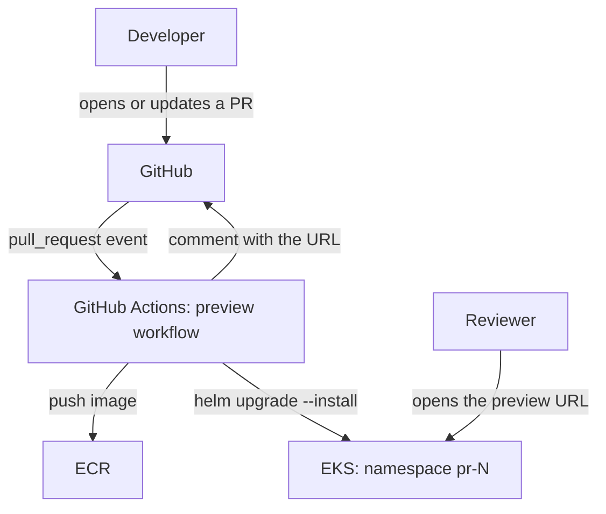
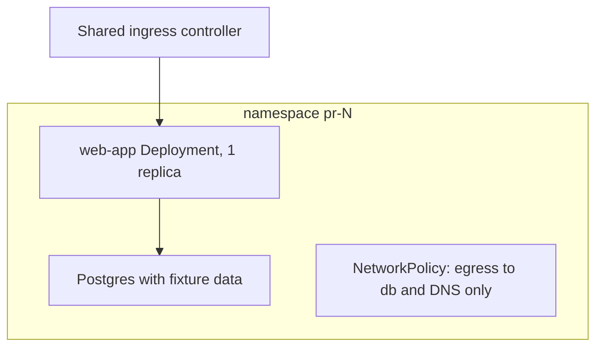
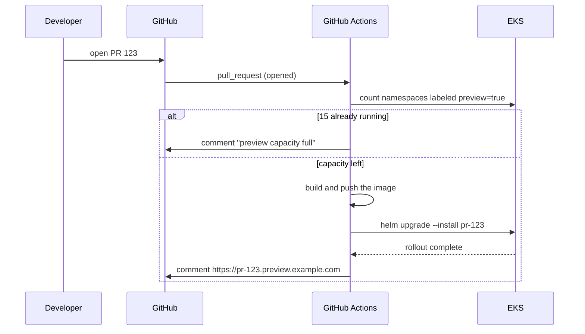
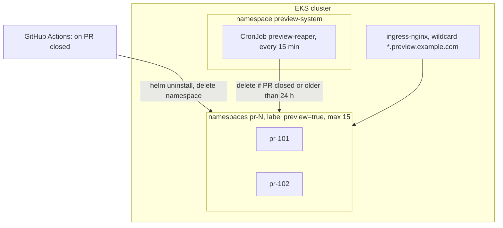

<!-- Adapted from jam01/SDD-Template@5dca2e5 (sdd-template-bare.md), CC0 1.0. Additions: front matter, 1.6 Requirements, record formats in Sections 3 and 4. -->

# Software Design Description
## For Per-PR preview environments

Version 0.1  
Prepared by Lim Eunhye  
Acme  
2026-10-06

## Table of Contents
<!-- TOC -->
* [1. Introduction](#1-introduction)
  * [1.1 Document Purpose](#11-document-purpose)
  * [1.2 Subject Scope](#12-subject-scope)
  * [1.3 Definitions, Acronyms, and Abbreviations](#13-definitions-acronyms-and-abbreviations)
  * [1.4 References](#14-references)
  * [1.5 Document Overview](#15-document-overview)
  * [1.6 Requirements](#16-requirements)
* [2. Design Overview](#2-design-overview)
  * [2.1 Stakeholder Concerns](#21-stakeholder-concerns)
  * [2.2 Selected Viewpoints](#22-selected-viewpoints)
* [3. Design Views](#3-design-views)
* [4. Decisions](#4-decisions)
* [5. Appendixes](#5-appendixes)
<!-- TOC -->

## Revision History
<!-- tracks document updates and reasons for change -->

| Name | Date | Reason For Changes | Version |
|------|------|--------------------|---------|
| Lim Eunhye | 2026-10-06 | Initial draft | 0.1 |

## 1. Introduction
<!-- overview of the SDD: purpose, scope, audience, and structure -->

### 1.1 Document Purpose
This SDD describes how per-PR preview environments are built and run. It is prescriptive: the system is built from it. Readers are the infra owner, design reviewers, the web team that uses the environments, and on-call. Claude Code implements against Sections 1.6, 3 and 4, and any design change is made in this file first.

### 1.2 Subject Scope
**System:** Preview environment pipeline, v1.

**Purpose:** every pull request on the web app repo gets a working copy of the app at its own URL, so reviewers can use the change before it merges.

**In scope:**
- build and deploy on PR open and on every push to the PR
- one URL per PR: `https://pr-<number>.preview.example.com`
- removal when the PR closes, plus a reaper for anything left behind
- a cap on how many environments run at once

**Out of scope:**
- production deploys
- seeding real or production data (each environment uses a fixed fixture)
- previews for backend repos (planned for v2)
- load testing

### 1.3 Definitions, Acronyms, and Abbreviations
| Term | Definition |
|------|------------|
| ADR | Architecture Decision Record: one design decision with the options considered and the reason for the choice |
| EKS | Amazon Elastic Kubernetes Service, the managed Kubernetes cluster the environments run on |
| Preview environment | A short-lived copy of the web app built from one PR's branch |
| Reaper | The CronJob that deletes preview environments whose PR is closed or that are older than the TTL |
| TTL | Time to live: how long an environment may exist before the reaper removes it (24 h) |

### 1.4 References
| Title | Owner | Version or date | Location | Type |
|-------|-------|-----------------|----------|------|
| web-app Helm chart | Web team | chart 2.3.0 | `charts/web-app` | Normative |
| GitHub Actions workflow syntax | GitHub | 2026 | https://docs.github.com/actions | Informative |
| SDD template | jam01 | 5dca2e5 | https://github.com/jam01/SDD-Template | Informative |

### 1.5 Document Overview
Section 1 sets the scope and the requirements (R1 to R4). Section 2 lists who cares about what and the four viewpoints chosen to answer them. Section 3 has one view per viewpoint, and each view names the requirements it implements. Section 4 records the two decisions that shaped the design. Changes are made in this file and tracked in the Revision History.

### 1.6 Requirements
| ID | Requirement | Acceptance check |
|----|-------------|------------------|
| R1 | While fewer than 15 environments run, a new PR gets a reachable preview environment within 10 minutes | Given 14 or fewer running environments and PR 123 opened at T0, then by T0 + 10 min `curl -fsS https://pr-123.preview.example.com/healthz` returns 200 |
| R2 | An environment is deleted within 1 hour of its PR closing | Given a closed PR, when 60 min pass, then `kubectl get ns pr-123` returns NotFound |
| R3 | A preview environment cannot reach production databases | Given a running environment, when a Job in namespace pr-123 runs `nc -z -w 3 <ip> 5432` against each production database IP, then every connection fails, while the same Job can connect to the environment's own Postgres |
| R4 | At most 15 preview environments run at once | Given 15 running environments, when a 16th PR opens, then CI comments "preview capacity full" on the PR and creates no namespace |

## 2. Design Overview
<!-- describes the system’s architecture and design approach -->

### 2.1 Stakeholder Concerns
| Stakeholder | Main concern | Addressed by |
|-------------|--------------|--------------|
| Reviewers (web team) | Is there a working link on my PR within minutes? | R1, V1, V3 |
| Infra owner | Can environments pile up or cost more than planned? | R2, R4, V4, ADR-002 |
| Security | Can a preview environment touch production data? | R3, V2, ADR-001 |
| On-call | Can I find and delete a stuck environment? | V4 |

### 2.2 Selected Viewpoints
Four viewpoints answer the concerns in 2.1. Not used: Logical, Physical, Structure, Dependency, Information, Interface, Algorithm, State Dynamics, Concurrency, Patterns, Resources, because the design wires existing components together and adds no new code paths or data stores.

#### 2.2.1 Context
Addresses: the system boundary and who triggers what (reviewers, on-call). Diagram: mermaid flowchart TB.

#### 2.2.2 Composition
Addresses: what runs inside one environment and how it is isolated (security). Diagram: mermaid flowchart TB with one subgraph per namespace.

#### 2.2.9 Interaction
Addresses: the steps from PR opened to a working URL, and their timing (reviewers). Diagram: mermaid sequenceDiagram.

#### 2.2.14 Deployment
Addresses: where each part runs, how environments are removed, and the cap (infra owner, on-call). Diagram: mermaid flowchart TB.

## 3. Design Views
### V1 Context: the pipeline and its neighbors
- **Viewpoint:** Context (2.2.1)
- **Implements:** R1
- **Decisions:** none

The pipeline starts only from GitHub `pull_request` events. Reviewers reach an environment through the shared ingress. Nothing outside this diagram calls the pipeline.

### V2 Composition: what runs inside one preview environment
- **Viewpoint:** Composition (2.2.2)
- **Implements:** R3
- **Decisions:** ADR-001

Each environment gets its own Postgres seeded from a fixed fixture, so no environment needs production data. The NetworkPolicy allows egress only to the environment's own database and to cluster DNS, which is what makes R3 testable.

### V3 Interaction: from PR opened to a working URL
- **Viewpoint:** Interaction (2.2.9)
- **Implements:** R1, R4
- **Decisions:** none

The capacity check runs before the build, so a full cluster costs no build minutes. The count and the namespace creation run in one GitHub Actions concurrency group, so two PRs cannot both take the last slot. The 10-minute budget in R1 splits into about 6 min of build, 2 min of rollout and 2 min of margin.

### V4 Deployment: where it runs and how it is removed
- **Viewpoint:** Deployment (2.2.14)
- **Implements:** R2, R4
- **Decisions:** ADR-001, ADR-002

Two paths remove an environment: the PR-closed workflow (normal path) and the reaper (catches failed or cancelled workflow runs). Either path alone meets R2: the workflow runs within minutes of the close, and the reaper runs every 15 minutes. On-call lists environments with `kubectl get ns -l preview=true`.

## 4. Decisions
### ADR-001 One namespace per PR
- **Status:** accepted
- **Context:** each PR needs an isolated environment (R3) that is ready within 10 minutes (R1).
- **Options:**
  - namespace per PR on the shared cluster
  - vcluster per PR
- **Outcome:** Chosen option: "namespace per PR", because it reuses the existing ingress, RBAC and node pool and is ready in seconds, while a vcluster adds a control plane per PR and about 2 minutes to startup.
- **More information:** V2, V4

### ADR-002 Two removal paths: PR-closed workflow and a reaper
- **Status:** accepted
- **Context:** environments must be gone within 1 hour of the PR closing (R2), and one failed workflow run must not leave an environment running.
- **Options:**
  - PR-closed workflow only
  - reaper CronJob only
  - both
- **Outcome:** Chosen option: "both", because the workflow removes the environment within minutes in the normal case, and the reaper catches runs that failed or were cancelled.
- **More information:** V4

## 5. Appendixes
_Not applicable: no supporting material for v1._
