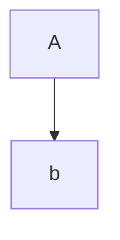

<!-- Adapted from jam01/SDD-Template@5dca2e5 (sdd-template-bare.md), CC0 1.0. -->

# Software Design Description
## For Mini example

Version 0.3  
Prepared by eeeemune  
Acme  
2026-10-06

## Table of Contents
<!-- TOC -->
* [1. Introduction](#1-introduction)
  * [1.1 Document Purpose](#11-document-purpose)
<!-- TOC -->

## Revision History
<!-- tracks document updates and reasons for change -->

| Name | Date | Reason For Changes | Version |
|------|------|--------------------|---------|
| eeeemune | 2026-10-01 | Initial draft | 0.1 |
|      |      |                    |         |

## 1. Introduction
<!-- overview of the SDD: purpose, scope, audience, and structure -->

### 1.1 Document Purpose
This line is wrapped
across two lines.

- **In scope:** build and deploy
  on every push
- nested parent
  - nested child with a|b and {x}

Costs $5 at 2^3 rps, about ~10 min, see [docs](https://example.com/a_b) or `a<b>`, not [this].

**TODO:** confirm the owner.

#### 2.2.1 Context
Addresses: boundary.

> A quote with <angle> text
